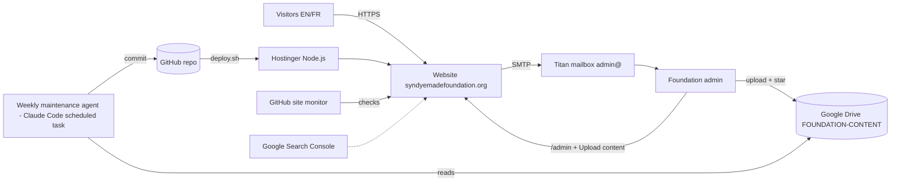
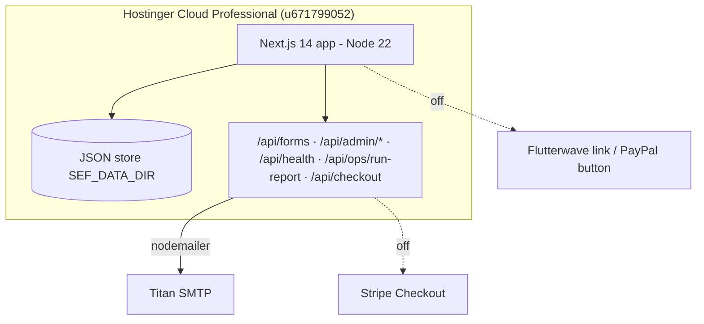
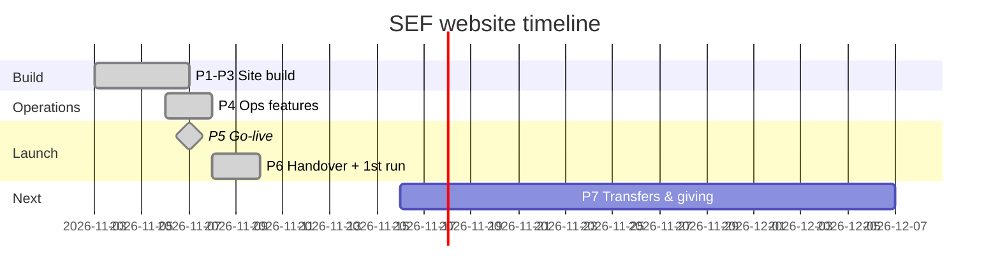

# Syndy Emade Foundation Website: End-to-End Project Documentation

## 0. Document Control

| Field | Value |
|---|---|
| Title | Syndy Emade Foundation Website: End-to-End Project Documentation |
| Version | v01 |
| Date | 2026-11-13 |
| Author | Tech Support (support@syndyemadefoundation.org), drafted with an AI assistant |
| Status | Draft for CEO review |
| Project stage | **Live** since 2026-11-07 [VERIFIED: S3, S4] |
| Owning company | Syndy Emade Foundation (Cameroon) [VERIFIED: S1 `lib/content.ts`]. Legal registration details: [UNKNOWN: registration number, legal form, registering authority] |
| Confidence | **High** for the build, hosting and operations sections (backed by the code and test reports). **Medium** for strategy and brand rationale (inferred from the site copy). **Low** for finance, legal and KPIs (mostly unknown). |

**Evidence tags used throughout**
- [VERIFIED: source]: backed by one of the sources below.
- [ASSUMED: reason]: reasonable inference, not confirmed.
- [RECOMMENDED]: a proposal, not a fact.
- [UNKNOWN: what's needed]: missing; listed in Open Questions (§13.3) and the Gaps checklist.

**Sources**

| Code | Source |
|---|---|
| S1 | Code repository `Foundation` (GitHub), branch `main`, commit 8507825 (2026-11-09): `lib/`, `app/`, `components/`, `tailwind.config.ts`, `package.json` |
| S2 | `docs/platform-operations-assessment.md` (environment assessment and proposed architecture, 2026-11-06/07) |
| S3 | `docs/launch-readiness-2026-11-07.md` (end-to-end test, NO-GO then GO on the real domain) |
| S4 | `docs/go-live-regression-2026-11-07.md` (go-live regression report) |
| S5 | `docs/platform-approvals.md` (items awaiting the Foundation's approval) |
| S6 | `docs/handover/admin-guide.md` and the Figma handover "Happy Birthday Syndy" (3 pages) |
| S7 | `ops/maintenance/JOB.md`, `LEARNINGS.md`, `last-run.json` (weekly maintenance, run 2026-11-09) |
| S8 | `.github/workflows/site-monitor.yml` and its GitHub Actions run history |
| S9 | Live checks with Firecrawl on 2026-11-09 (`/api/health`, `/`, `/fr`, `/stories`, `/media`: all HTTP 200) |
| S10 | Build-session records 2026-11-03 to 2026-11-09 (domain recovery, DNS, Search Console, email set-up) |

**Secrets policy:** this document holds no passwords, keys or tokens. Credentials are given as "Secure reference: <vault entry>". [RECOMMENDED: create these entries in the Foundation's password manager.]

---

## 1. Executive Summary

**Pitch.** www.syndyemadefoundation.org is the Syndy Emade Foundation's bilingual (English/French) website. It shows the Foundation's documented work with vulnerable children and displaced families in Cameroon, and it turns visitors into volunteers, partners, press contacts and donors. A light weekly maintenance service keeps it current from a shared Google Drive. [VERIFIED: S1, S9]

- **Problem.** Before this project the domain was parked: there was no website, no email on the domain, and the Foundation's work was scattered across social posts and press articles. Nothing documented it in one trustworthy place. [VERIFIED: S2 §1]
- **Solution.**
  - A Next.js website with 9 documented Stories of Impact, 5 programme pages, an impact dashboard, an accountability centre and a media & press hub.
  - Forms with reference numbers, and an admin dashboard.
  - Foundation email (admin@, contact@, info@, support@).
  - Weekly AI-assisted content maintenance, with nothing published until the admin approves it.
  [VERIFIED: S1, S4, S7]
- **Target users.** Donors and supporters (diaspora and local), volunteers, corporate/NGO/media partners, journalists, and the Foundation's own admins. [VERIFIED: S1 form types and partner options]
- **Current stage.** Live since 2026-11-07, SSL on, indexed by Google, sitemap submitted. The first weekly maintenance run on 2026-11-09 found the site healthy. [VERIFIED: S3, S7, S10]

**Top 3 risks**
1. **Account ownership.** The hosting, Drive, Search Console and GitHub accounts still sit under the build team's personal account, not a Foundation-owned identity. [VERIFIED: S10]
2. **No content pipeline yet.** The Drive upload folders are empty, so the site goes stale unless someone uploads and approves content. [VERIFIED: S7]
3. **No online giving.** Donations happen by contact only, so donor conversion depends on email follow-up. [VERIFIED: S1 `lib/giving.ts`]

**Next decision needed (CEO).**
- Move all service accounts to Foundation-owned logins.
- Approve the pending content items in §13.3.
- Decide whether, and with which provider, to switch on online giving (Flutterwave Mobile Money, PayPal and/or card through Stripe).

---

## 2. Concept & Strategy

**Vision.** [UNKNOWN: an official vision statement. The site's tagline is "Together we can." / "Ensemble, nous pouvons."] [VERIFIED: S1]

**Mission (as stated on the site).** To stand with vulnerable children and displaced families in Cameroon through school supplies and fees, food and essentials, Christmas outreach, and the fight against child exploitation. [VERIFIED: S1 site metadata]

**Problem statement.** The Foundation had real, press-documented impact but no credible owned channel to show it, receive offers of help, or account for it. [VERIFIED: S2]

**Value proposition.** Every claim on the site is backed by a documented source. Figures link to their story, quotes are verbatim from published articles, and unconfirmed items are labelled or hidden. This builds donor and partner trust. [VERIFIED: S5 "only documented facts are published as achievements"]

**Target market and personas** [ASSUMED: derived from site features and form types]

| Persona | Need | Site answer |
|---|---|---|
| Diaspora donor | Trust that money reaches people | Stories, accountability centre, Donate (contact to give) |
| Local volunteer | Know how to help | Get Involved paths and volunteer form |
| Corporate/NGO partner | Credibility and a project record | Partners page, proposal PDF, partner form |
| Journalist | Facts, photos, contacts | Media & Press hub, press kit, fact sheets EN/FR |
| Foundation admin | Low-effort upkeep | /admin, Upload content, weekly report |

**Competitors and differentiation.** [UNKNOWN: no competitive analysis was done. Other Cameroonian youth and humanitarian foundations are the likely comparison set.] Differentiators in place: bilingual parity, an evidence-first content policy, and the founder's public profile as an actor and producer. [VERIFIED: S1 founder and creative-legacy pages]

**Business model and revenue streams.** Non-profit, donation- and partnership-funded. Online payment rails are built but switched off: Stripe card in USD/XAF, Flutterwave Mobile Money link, PayPal Donate button. [VERIFIED: S1 `lib/giving.ts`, `app/api/checkout`]. Revenue figures: [UNKNOWN].

**Success metrics** [RECOMMENDED: none were agreed]
- Monthly visitors and Search Console clicks
- Form submissions per type per month
- Donation enquiries per month and their conversion
- Stories published per quarter
- Uptime ≥ 99.5%

**OKR example** [RECOMMENDED]
- **Objective:** a credible, current online home.
- **Key results:**
  - 1 new approved story or news item per month
  - 0 unresolved site-monitor issues
  - 10 qualified partner or volunteer enquiries per quarter

**Assumptions to validate**
- Donors prefer Mobile Money in Cameroon and PayPal or card abroad. [ASSUMED]
- Admins will upload content weekly. [ASSUMED]
- Bilingual content raises reach in francophone Cameroon. [ASSUMED]

---

## 3. Scope

**In scope (delivered)** [VERIFIED: S1, S4]
- 28 EN + 28 FR pages.
- Stories, programmes, pillars, founder and creative-legacy pages.
- Impact dashboard and map, accountability centre, partners page and partnership proposal PDF.
- Media hub with films, journey timeline, press, press kit and fact sheets.
- Donate (contact to give).
- Forms with reference IDs.
- /admin dashboard, health endpoint, site monitor, weekly maintenance and report email.
- Foundation mailboxes; domain, SSL and SEO (sitemap, JSON-LD, Search Console).

**Explicitly out of scope** [VERIFIED: S5 "Not built in this round"]
- A CMS or back office.
- Partner/volunteer CRM.
- Per-project photo galleries beyond the available photos.
- A new introduction video.
- Live online payments (built, switched off).

**Constraints**
- **Budget:** [UNKNOWN].
- **Legal:** consent is required for identifiable children and vulnerable people [VERIFIED: S7 rule 3].
- **Technical:** Hostinger Node.js hosting; environment changes only take effect after an hPanel Redeploy [VERIFIED: S10].
- **Time:** launched for Syndy Emade's birthday, 2026-11-07 [ASSUMED: from the handover title].

**Dependencies**
- GoDaddy (domain and DNS), Hostinger (hosting and Titan email), Google (Drive and Search Console), GitHub (code and monitor).
- The scheduled AI maintenance task (Claude Code), with Google Drive and Firecrawl connectors. [VERIFIED: S7, S10]

---

## 4. Brand & Visual Identity

- **Name rationale.** Named after its founder, Syndy Emade, a Cameroonian actress and producer [VERIFIED: S1 profiles: Wikipedia, IMDb]. Launched 2019-07-11 at Mabanda-Bonaberi, Douala [VERIFIED: S5].
- **Tagline.** "Together we can." / "Ensemble, nous pouvons." [VERIFIED: S1]
- **Tone of voice.** Warm, factual and dignified. Say "young people", not "street children" [VERIFIED: S7 LEARNINGS]. No exaggerated claims.
- **Messaging pillars.** Five strategic pillars [VERIFIED: S1 `lib/platform.ts`]:
  - Education & Youth Development: *active*
  - Humanitarian Relief: *active*
  - Women Empowerment: *emerging*
  - Community Development: *proposed*
  - Environmental Sustainability: *proposed*

### 4.1 Color system
Source: `tailwind.config.ts`, the official logo palette [VERIFIED: S1]. Contrast ratios were computed to WCAG 2.x on 2026-11-13.

| Role | Token | HEX | RGB | Usage rule | Contrast check |
|---|---|---|---|---|---|
| Primary | teal | #00A8A0 | 0,168,160 | Fills, accents, text on dark | 3.0:1 on white (large text/graphics only); 5.7:1 on plum ✅ |
| Primary text | teal-600 | #00756F | 0,117,111 | Teal text, white-text buttons on light | 5.6:1 on white ✅ AA |
| Primary strong | teal-700 | #00635E | 0,99,94 | Small teal text | 7.1:1 on white ✅ AAA |
| Secondary | purple | #703890 | 112,56,144 | Brand accents, buttons | White on purple 7.9:1 ✅ AAA |
| Secondary dark | purple-700 | #5C2D77 | 92,45,119 | Hover, emphasis | 10.0:1 on white ✅ |
| Dark/neutral | plum | #2A1238 | 42,18,56 | Dark sections, body text | 16.9:1 on white ✅ |
| Darkest | plum-900 | #1C0B26 | 28,11,38 | Footers, overlays | 18.7:1 on white ✅ |
| Canvas | mist | #F7FAFA | 247,250,250 | Page background | Plum on mist 16.1:1 ✅ |
| Ink | ink | #111111 | 17,17,17 | Plain text | 18.9:1 on white ✅ |
| Tint | teal-50 / purple-50 | #ECF8F7 / #F4EEF8 | 236,248,247 / 244,238,248 | Card backgrounds | Plum text 15.6 / 14.8:1 ✅ |
| Success | teal-700 on teal-50 | #00635E / #ECF8F7 | — | Confirmations | 6.6:1 ✅ |
| Warning | amber-800 on amber-50 | #92400E / #FFFBEB | 146,64,14 | Notices, "to confirm" labels | 6.8:1 ✅ |
| Error | red-700 on red-50 | #B91C1C / #FEF2F2 | 185,28,28 | Form errors | 5.9:1 ✅ |

The semantic colors are Tailwind defaults used in the components [VERIFIED: S1]. There are no named semantic tokens [RECOMMENDED: add `success`, `warning` and `error` tokens].

### 4.2 Typography, logo, imagery, layout
- **Typography** [VERIFIED: S1 `app/[locale]/layout.tsx`]:
  - Display: **Poppins** 500/600/700.
  - Body: **Plus Jakarta Sans**, with **Inter** as fallback.
  - Scale in use (Tailwind): xs 12, sm 14, base 16, lg 18, xl 20, 2xl 24, 3xl 30, 4xl 36, 5xl 48, 6xl 60, 7xl 72 px.
- **Logo.** `public/brand/logo-original.png` (teal and purple wordmark "Syndy Emade Foundation · Together we can"). On dark backgrounds, place it on a white rounded tile [VERIFIED: S6 Figma].
- **Iconography.** lucide-react 0.468 [VERIFIED: S1].
- **Imagery.**
  - Real outreach photos only, with captions, dates and places.
  - No stock images.
  - No identifiable children or patients without consent [VERIFIED: S7].
- **Spacing and grid.** Content max width 72rem (1152px); extra spacing tokens 18 (4.5rem) and 22 (5.5rem); card shadow and glow tokens [VERIFIED: S1].

### 4.3 Design tokens (export-ready)
```json
{
  "color": {
    "teal": {"DEFAULT":"#00A8A0","50":"#ECF8F7","100":"#D3F0EE","300":"#7FD6D0","400":"#33BAB3","600":"#00756F","700":"#00635E"},
    "purple": {"DEFAULT":"#703890","50":"#F4EEF8","100":"#E7D9F0","400":"#B48ACB","700":"#5C2D77","800":"#47225C"},
    "plum": {"DEFAULT":"#2A1238","700":"#4E2A63","800":"#3A1C4D","900":"#1C0B26"},
    "mist": {"DEFAULT":"#F7FAFA","100":"#EEF4F4"},
    "ink": "#111111",
    "success": {"fg":"#00635E","bg":"#ECF8F7"},
    "warning": {"fg":"#92400E","bg":"#FFFBEB"},
    "error": {"fg":"#B91C1C","bg":"#FEF2F2"}
  },
  "font": {"display":"Poppins","body":"Plus Jakarta Sans","fallback":"Inter"},
  "size": {"xs":12,"sm":14,"base":16,"lg":18,"xl":20,"2xl":24,"3xl":30,"4xl":36,"5xl":48,"6xl":60,"7xl":72},
  "layout": {"contentMax":"72rem","space18":"4.5rem","space22":"5.5rem"},
  "shadow": {"card":"0 1px 2px rgb(42 18 56 / 0.05), 0 10px 30px -12px rgb(42 18 56 / 0.18)",
             "glow":"0 0 0 1px rgb(0 117 111 / 0.25), 0 12px 32px -10px rgb(0 168 160 / 0.55)"}
}
```
The success, warning and error entries are [RECOMMENDED] names for values already in use.

---

## 5. Product & UX Design

**User journeys** [VERIFIED: S1 routes; tested in S4]
- **Donor:** Home → Donate button (popup) → email support@ or "Prefer to give your time?" → /get-involved. Or: Home → /donate → contact to give.
- **Volunteer:** /get-involved → choose a path → volunteer form → on-screen reference number (e.g. SEF-VOL-…) and an acknowledgement email.
- **Partner:** /partners → proposal PDF → partner form → acknowledgement email; admin@ is notified.
- **Journalist:** /media → films, timeline, press → press kit ZIP and fact sheets → press form.
- **Admin:**
  - /admin → sign in → read and filter messages → reply from admin@ → retry failed emails.
  - To add content: /admin → **Upload content** → Drive folder → star the file to approve → it is published on the Monday run.

**Sitemap (EN | FR)** [VERIFIED: S6]

| Page | English | French |
|---|---|---|
| Home | / | /fr |
| About | /about | /fr/a-propos |
| Founder | /founder | /fr/fondatrice |
| Projects (5) | /projects | /fr/projets |
| Stories of Impact (9) | /stories | /fr/histoires |
| Impact | /impact | /fr/impact |
| Accountability | /accountability | /fr/transparence |
| Partners | /partners | /fr/partenaires |
| Get involved | /get-involved | /fr/s-engager |
| Creative legacy | /creative-legacy | /fr/heritage-creatif |
| Media & press | /media | /fr/medias |
| Donate | /donate | /fr/faire-un-don |
| Privacy | /privacy | /fr/confidentialite |
| Donation policy | /donation-policy | /fr/conditions-de-don |
| Admin (private) | /admin | — |

**Key screens**
- **Home:** hero with counters (600+ children equipped …), pillars, impact highlights, latest stories, CTA band.
- **Story page:** challenge → what we did → what changed → people's words, plus a photo gallery with lightbox.
- **Media hub:** filterable library with deep links (#story-…).
- **Admin dashboard:** "Needs your attention", search and filter, delivery status, maintenance status, Upload content.

[VERIFIED: S1, S4; admin screenshots `docs/admin-dashboard-*.png`]

**Component inventory** [VERIFIED: S1 `components/`]. There are 40 components, including:
- Navbar, Footer, Hero, PageHero, SectionHeading
- PillarCards, ProjectCard, StoryCard, PhotoGallery, MediaGallery, MediaHub, FilmTimeline, Journey
- ImpactDashboard, ImpactMap, Counter
- DonateProvider/DonationForm, EngageForm, InvolveForm, PressForm, NewsletterForm
- Modal, CampaignBanner, WhatsAppButton (hidden), LegalPage, Logo, Reveal

**Accessibility.**
- Measured: 0 automated accessibility issues at launch [VERIFIED: S3/S4].
- Palette meets AA (see §4.1).
- Popups close with the X button and with Escape [VERIFIED: S4 E2E].
- [RECOMMENDED: a manual WCAG 2.2 AA audit covering focus order, target size 24px and screen-reader labels.]

**Localization.** English and French are kept in sync. French translations of English quotes are marked "(traduit de l'anglais)" [VERIFIED: S5]. The language switch keeps the current page [VERIFIED: S4].

**Empty and error states**
- Campaigns are hidden until a verified campaign exists, and /get-involved shows an explainer instead [VERIFIED: S5].
- Unknown routes go to a catch-all page [VERIFIED: S1 `[...rest]`].
- With online giving off, the checkout returns "being set up" [VERIFIED: S1].
- Offline/PWA support: [UNKNOWN: not built].

---

## 6. Functional Requirements
Owner key: TS = Tech Support; AD = Foundation admin.

| ID | User story | Acceptance criteria (Given/When/Then) | MoSCoW | Owner | Status |
|---|---|---|---|---|---|
| F1 | As a visitor I want each page in EN and FR so that I can read it in my language | Given any page, when I click the language switch, then the same page opens in the other language | Must | TS | Live [VERIFIED: S4] |
| F2 | As a volunteer I want to apply online so that the Foundation can contact me | Given a valid form, when I submit it, then I see a reference number, receive an acknowledgement and admin@ is notified | Must | TS | Live [VERIFIED: S4 live form test] |
| F3 | As an admin I want to read every submission so that nothing is missed | Given I sign in at /admin, when submissions exist, then I can search, filter and retry failed emails | Must | TS | Live [VERIFIED: S1, S4] |
| F4 | As a donor I want a clear way to give so that I can help | Given I click Donate, when the popup opens, then I can email support@ or go to Get Involved, and the popup closes | Must | TS | Live [VERIFIED: S4] |
| F5 | As a donor I want to pay online | Given a payment method is configured, when I choose an amount, then I am taken to checkout | Should | AD+TS | Built, off [VERIFIED: S1] |
| F6 | As an admin I want to add content without code | Given I upload a file and star it, when the Monday run happens, then it is published or I get a question | Must | AD | Live, unused so far [VERIFIED: S7] |
| F7 | As an admin I want a weekly report | Given Monday 06:17 Douala, when the run ends, then the report is emailed and shown on /admin | Must | TS | Live [VERIFIED: S7, 2026-11-09 "sent"] |
| F8 | As a journalist I want a press kit | Given /media, when I click download, then the ZIP and PDFs download | Should | TS | Live [VERIFIED: S4] |
| F9 | As a visitor I want to see evidence of impact | Given a figure, when I click it, then it opens its source story | Must | TS | Live [VERIFIED: S5] |
| F10 | As a visitor I want to contact by WhatsApp | Given a confirmed number, then the button shows | Could | AD | Hidden [VERIFIED: S5] |
| F11 | As a supporter I want to back a specific campaign | Given a verified need with a target, then the campaign banner shows | Could | AD | Hidden [VERIFIED: S5] |

---

## 7. Non-Functional Requirements
- **Performance.** Static generation of the content pages with Next.js 14 [VERIFIED: S1]. [UNKNOWN: Lighthouse and Core Web Vitals scores. RECOMMENDED target: LCP < 2.5 s on 4G.]
- **Availability.**
  - The /api/health endpoint checks storage and mail [VERIFIED: S9].
  - The GitHub site monitor checks the site; GitHub actually runs it about every 4 hours, and all 9 runs in the week to 2026-11-09 passed [VERIFIED: S8].
  - [RECOMMENDED: 99.5% target; add a free external 5-minute uptime monitor.]
- **Security.**
  - HTTPS with an auto-installed SSL certificate [VERIFIED: S10].
  - Admin login with a password from an environment variable, checked server-side [VERIFIED: S1 `admin-auth.ts`].
  - The data directory is created with mode 700 [VERIFIED: S1 `store.ts`].
  - No secrets in the repo [VERIFIED: S7 rule 7].
  - Hostinger has flagged npm package vulnerabilities to review [VERIFIED: S4 open item 5].
- **Privacy.**
  - A privacy policy page exists [VERIFIED: S1].
  - Form data is stored on the server in JSON files under `SEF_DATA_DIR` [VERIFIED: S1].
  - Retention period: [UNKNOWN].
  - No personal data or comment screenshots are published [VERIFIED: S7].
- **Scalability.** One Node.js process on Hostinger Cloud Professional, which is sufficient for NGO traffic [ASSUMED]. The file-based store suits low volumes [ASSUMED].
- **Observability.**
  - Health endpoint, GitHub monitor issues labelled `site-monitor`, an email delivery log, and the weekly report [VERIFIED: S1, S7, S8].
  - Monitor email alerts: not configured [VERIFIED: S8 comment].
- **Compliance.**
  - Cameroon data protection law: [UNKNOWN: legal review].
  - Card payments, if switched on, are handled by Stripe Checkout (PCI handled by Stripe) [VERIFIED: S1 Stripe Checkout use].
  - Founder photo under CC BY-SA 4.0 with attribution [VERIFIED: S1].

---

## 8. Technical Architecture

### 8.1 System context


### 8.2 Containers


- **Stack and rationale** [VERIFIED: S1]:
  - Next.js 14.2.35 with the App Router, React 18.3.1 and TypeScript 5.7.2.
  - Tailwind 3.4.17, framer-motion and lucide-react.
  - nodemailer for SMTP; Stripe 17.5 for card checkout (off).
  - Rationale: content lives as typed data in Git, so every change is a reviewable commit and rollback is a revert, with no CMS or database to run [VERIFIED: S2 §2].
- **Data model** [VERIFIED: S1]:
  - Content entities live in `lib/content.ts`, `lib/platform.ts` and `lib/gallery.ts`: Story, Project (5), Pillar (5), Journey entry, Film, Press item, Partner (2 documented: Elone Foundation, Wilmbi Foundation), Campaign, Indicator, Gallery image.
  - Runtime entities:
    - **Submission:** `type` = newsletter, volunteer, partner, collaboration or press; `ref`; contact fields.
    - **Delivery status:** admin and acknowledgement flags.
    - **MaintenanceRun:** `ops/maintenance/last-run.json`.

**Integrations**

| Integration | Purpose | Status |
|---|---|---|
| Titan SMTP | Notifications, acknowledgements, weekly report | **Live** [VERIFIED: S9 mail:true] |
| Google Drive (connector) | Content intake | **Live**, 7 folders empty [VERIFIED: S7] |
| Firecrawl | Live checks and report trigger | **Live** [VERIFIED: S7] |
| GitHub Actions | Site monitor | **Live** [VERIFIED: S8] |
| Google Search Console | Indexing | **Live**, sitemap "Success" [VERIFIED: S10] |
| Stripe / Flutterwave / PayPal | Online giving | **Built, switched off** [VERIFIED: S1] |
| FORMS_WEBHOOK_URL (CRM/Zapier) | Forwarding submissions | **Not set** [VERIFIED: S2] |
| Hostinger cron worker + MySQL + Claude API | Earlier proposed design | **Planned only, not built**. Replaced by the scheduled task and Git [VERIFIED: S2 vs S7] |

- **Auth and roles.** A single admin role, with one password (`ADMIN_PASSWORD`) and a session cookie [VERIFIED: S1]. Secure reference: Vault › SEF › Website admin password.
- **Environments** [VERIFIED: S1, S10]:
  - **Dev:** local `npm run dev` / production build on port 3096.
  - **Staging:** none; the earlier preview subdomain was deleted.
  - **Production:** www.syndyemadefoundation.org.
  - [RECOMMENDED: a Hostinger staging site with `NEXT_PUBLIC_NOINDEX=true`.]
- **Hosting and CI/CD** [VERIFIED: S7, S10]:
  - Push to `main`.
  - `ops/maintenance/deploy.sh` runs a duplicate-content check and calls the Hostinger API: a git deploy of the `hostinger-archive` branch, then a Node build.
  - Changes to environment variables need **Redeploy** in hPanel.
- **Settings (names only).** SMTP_HOST, SMTP_PORT, SMTP_USER, SMTP_PASS, ADMIN_EMAIL, MAIL_REPLY_TO, ADMIN_PASSWORD, NEXT_PUBLIC_SITE_URL, NEXT_PUBLIC_NOINDEX, SEF_TIMEZONE [VERIFIED: S6]. Secure reference: Vault › SEF › Hostinger environment.
- **Backups and restore.**
  - **Code:** in Git; the site was rebuilt from GitHub after an accidental deletion on 2026-11-07 [VERIFIED: S7 LEARNINGS].
  - **Hosting:** Hostinger daily backups [VERIFIED: S2].
  - **Form data:** [UNKNOWN: whether the backups include `SEF_DATA_DIR`; restore not tested].

---

## 9. Domains, Digital Presence & Accounts

**Domains**
- Primary: syndyemadefoundation.org, registered at GoDaddy on 2026-11-03, expiring 2027-11-03 [VERIFIED: S2].
- Canonical host: www [VERIFIED: S1].
- syndyemadefoundation.com is not registered [VERIFIED: S2, as of 2026-11-06]. [RECOMMENDED: register it and redirect.]
- Subdomains per environment: none [RECOMMENDED: staging.syndyemadefoundation.org].

**DNS at GoDaddy (do not delete)** [VERIFIED: S6]
- A @ 145.223.122.250
- CNAME www → @
- MX mx1/mx2.titan.email
- SPF `v=spf1 include:spf.titan.email ~all`
- DKIM titan1._domainkey
- DMARC _dmarc
- google-site-verification TXT

**Email** [VERIFIED: S6]
- admin@ is the mailbox (Titan).
- contact@, info@ and support@ forward to it.
- A branded signature is set up.

**SSL.** Installed by Hostinger and auto-renewing [VERIFIED: S10].

**Social** [VERIFIED: S1]
- facebook.com/SyndyEmadeFoundation
- instagram.com/syndyemadefoundationcmr
- Founder channels (not the Foundation's): Facebook SyndyEmadeofficial, YouTube "Syndy Emade TV" [VERIFIED: S7 LEARNINGS]

**App stores.** None.

**Accounts register**

| Service | Purpose | Current owner | Secure reference |
|---|---|---|---|
| Hostinger (hPanel) | Hosting, Redeploy, SSL, Titan plan | Build team's account (transfer pending) [VERIFIED: S10] | Vault › SEF › Hostinger |
| Titan webmail | admin@ mailbox | Foundation | Vault › SEF › admin@ mailbox |
| GoDaddy | Domain and DNS | Foundation GoDaddy login [VERIFIED: S6] | Vault › SEF › GoDaddy |
| Website /admin | Messages, Upload content | Foundation | Vault › SEF › Website admin password |
| Google Drive FOUNDATION-CONTENT | Content intake | Build team's Google account (transfer pending) | Vault › SEF › Google |
| Google Search Console | Indexing | Build team's Google account (transfer pending) | Vault › SEF › Google |
| GitHub `Foundation` repo | Code, monitor | Build team's GitHub (transfer pending) | Vault › SEF › GitHub |
| Figma | Designs, handover | [UNKNOWN: owner] | Vault › SEF › Figma |
| Claude Code scheduled task | Weekly maintenance | Build team's Claude account | — |

---

## 10. Legal, Compliance & Finance

**Entity and registration**
- The site says "Registered non-profit · Cameroon" [VERIFIED: S1].
- [UNKNOWN: registration number, legal form, date, authority, and tax or charity status abroad (e.g. US 501(c)(3)-equivalent) for donors.]

**Policies**
- Privacy policy and donation policy pages exist in EN and FR [VERIFIED: S1].
- [UNKNOWN: legal review of both.]
- Terms of use: not present [RECOMMENDED].

**Data processing**
- The site collects contact details from forms [VERIFIED: S1].
- Consent rules for children and vulnerable people apply [VERIFIED: S7].
- [UNKNOWN: a data controller statement and the retention period.]

**Payment providers.** Stripe (card, USD/XAF, limits USD 5–50,000 and XAF 1,000–30,000,000), Flutterwave and PayPal are all switched off [VERIFIED: S1].

**Pricing.** Not applicable (donations).

**Cost model**
- Domain: [UNKNOWN: GoDaddy price].
- Hostinger Cloud Professional: [UNKNOWN: price; an existing plan is shared with other client sites, VERIFIED: S2].
- Titan mailbox: "a few dollars a month" [ASSUMED: S2 estimate].
- Google, GitHub and Search Console: free [VERIFIED: S2].
- AI maintenance: [UNKNOWN: who pays].
- One-time build cost: [UNKNOWN].

**Budget and break-even.** [UNKNOWN]. Not meaningful for a non-profit site. [RECOMMENDED: track running cost per year against donations attributed to the site.]

---

## 11. Go-to-Market

- **Launch audience.**
  - Existing Facebook and Instagram followers, the founder's fan base, partners (Elone Foundation, Wilmbi Foundation) and Cameroonian press [ASSUMED].
  - Launch date: 2026-11-07, Syndy Emade's birthday [ASSUMED: handover title].
- **Channels** [RECOMMENDED]:
  - Link in the social bios.
  - Announcement posts in EN and FR.
  - Email from admin@ to past partners.
  - Press release to the outlets already cited on /media.
- **Content plan.** At least one approved item a month via Upload content; the weekly report shows what was published [RECOMMENDED; mechanism VERIFIED: S7].
- **Partnerships.** Partnership proposal PDF and partner form [VERIFIED: S1]. "Each partnership gets a public project record" still needs Foundation agreement [VERIFIED: S5].
- **Promotions.** "One Act of Kindness" campaigns, hidden until a verified need exists [VERIFIED: S5].
- **Support model.**
  - Visitors write to contact@ and info@.
  - Donors, volunteers and accountability questions go to support@.
  - Tech Support: support@ [VERIFIED: S1, S6].
- **Feedback loop.**
  - Form submissions in /admin.
  - Search Console performance, checked monthly.
  - Weekly report questions to the admin [VERIFIED: S6, S7].

---

## 12. Implementation Plan

**Phases (actual)** [VERIFIED: git history S1, S3, S4, S7]

| Phase | Dates | Outcome |
|---|---|---|
| P1 Build: stories, pillars, founder, home | 2026-11-03 | Initial site and preview |
| P2 Impact, Get Involved, Partners, proposal PDF | 2026-11-03 → 11-06 | Done |
| P3 Accountability, galleries, media hub | 2026-11-06 | Done |
| P4 Operations: forms, admin, mail, Drive, monitor, maintenance | 2026-11-06 → 11-07 | Done |
| P5 Launch: domain recovery, SSL, E2E, regression | 2026-11-07 | GO, live |
| P6 Handover and first maintenance run | 2026-11-08 → 11-09 | Done |
| P7 Account transfer, content approvals, online giving | 2026-11 → 2026-12 | [RECOMMENDED], not started |



**Work breakdown (top level).** Content and data → UI and i18n → forms and admin → email and DNS → hosting and deploy → monitoring and maintenance → QA → handover.

**RACI** [ASSUMED: roles inferred]

| Activity | CEO/Founder | Foundation admin | Tech Support |
|---|---|---|---|
| Content approval (star) | A | R | C |
| Facts and consent confirmation | A | R | C |
| Code, deploy, monitoring | I | I | R/A |
| Accounts and billing | A | R | C |
| Weekly report review | I | R/A | R |

**Resourcing.**
- One technical lead (Tech Support) working with an AI agent.
- One Foundation admin.
- Admin time needed: [UNKNOWN: hours per week].

**Quality gates (used at launch)** [VERIFIED: S3, S4]

| Gate | Result |
|---|---|
| Pages load | 56/56 pages = 200 |
| Links | 66/66 links OK |
| Accessibility | 0 automated issues |
| Buttons | 357 controls clicked, 0 errors |
| Forms | All forms pass; live acknowledgement and admin emails received |
| Mobile | OK |
| Duplicate content | No duplicates (deploy.sh) |

**Test strategy**
- Typecheck and build on every change [VERIFIED: S1 scripts].
- E2E: Playwright scripts against a production build [VERIFIED: S4].
- UAT: admin form test, done 2026-11-07 [VERIFIED: S10].
- [RECOMMENDED: unit tests for `submissions.ts` and `content-repo.ts`, which have none today.]

**Release and rollback**
- Release: commit → push → `deploy.sh` → Firecrawl check [VERIFIED: S7].
- Rollback: `git revert` and redeploy [VERIFIED: S2 §2].

---

## 13. Risks & Decisions

### 13.1 Risk register
| # | Risk | L | I | Mitigation | Owner |
|---|---|---|---|---|---|
| R1 | Service accounts held under a personal login | High | High | Transfer to Foundation identities; record in vault | CEO + TS |
| R2 | Site content goes stale | Med | Med | Monthly upload target; weekly report reminders | Admin |
| R3 | Publishing identifiable children without consent | Low | High | Star-to-approve + consent rule + held photos [VERIFIED: S7] | Admin |
| R4 | Destructive hosting changes (site deleted 2026-11-07) | Low | High | Check the account before deleting; restore from Git [VERIFIED: S7] | TS |
| R5 | npm vulnerabilities flagged by Hostinger | Med | Med | Review and update packages | TS |
| R6 | Domain expiry 2027-11-03 | Low | High | Auto-renew at GoDaddy [RECOMMENDED] | Admin |
| R7 | Monitor runs only about every 4 h and alerts reach GitHub only | Med | Med | External uptime monitor + email alerts | TS |
| R8 | Form data loss (file store) | Low | Med | Confirm backups cover SEF_DATA_DIR; test a restore | TS |
| R9 | Maintenance relies on one person's AI session | Med | Med | Document JOB.md (done); transfer the task to a Foundation account | TS |

### 13.2 Decision log
| ID | Decision | Date | Decided by | Status |
|---|---|---|---|---|
| D1 | GoDaddy for domain/DNS only; hosting and email on Hostinger | 2026-11-06 | Project owner [ASSUMED] | Done [VERIFIED: S2] |
| D2 | Content in Git, no CMS; Drive as the upload repository | 2026-11-06 | Project owner | Done [VERIFIED: S2] |
| D3 | Weekly scheduled maintenance instead of the planned cron + MySQL worker | 2026-11-07 | Project owner | Live [VERIFIED: S7] |
| D4 | Donations by contact until a payment provider is chosen | 2026-11-07 | Project owner | Live [VERIFIED: S1] |
| D5 | Go live on syndyemadefoundation.org | 2026-11-07 | Project owner | Done [VERIFIED: S3] |
| D6 | Publish only starred (approved) content; hold photos without consent | 2026-11-07 | Admin | Live [VERIFIED: S7] |
| D7 | Handover documents name Foundation addresses only | 2026-11-08 | Project owner | Done [VERIFIED: S6] |

### 13.3 Open questions
| # | Question | Owner |
|---|---|---|
| Q1 | Foundation legal registration details and tax status | CEO |
| Q2 | Who will own each service account after transfer | CEO |
| Q3 | Confirm "CFI Partner", what each donation amount funds, and the annual impact report promise | CEO/Admin |
| Q4 | Consent or identification for the photos on hold | Admin |
| Q5 | Approve the founder statement (or Syndy's own words) | Syndy Emade |
| Q6 | WhatsApp number for the button | Admin |
| Q7 | Women Empowerment activity date; status of the Community and Environment pillars | Admin |
| Q8 | Was the Christmas 2023 renovation completed? | Admin |
| Q9 | Which resources per project may be disclosed | CEO |
| Q10 | Online giving: which providers, and who holds the accounts | CEO |
| Q11 | Running budget and who pays hosting, email and AI maintenance | CEO |
| Q12 | Data retention period for form submissions | CEO + TS |

---

## 14. Operations & Maintenance

- **Monitoring.**
  - /api/health (storage and mail).
  - GitHub site monitor, scheduled every 15 min; GitHub runs it about every 4 h. Alerts open a `site-monitor` GitHub issue [VERIFIED: S8].
  - Weekly live checks of 5 key URLs [VERIFIED: S7].
- **Incident response** [VERIFIED: S6 troubleshooting table]:
  1. Open /api/health.
  2. Check "Running" in hPanel.
  3. Redeploy.
  4. Contact Tech Support.
  5. If settings changed: fix the value, then Redeploy.
  6. If emails fail: check SMTP_PASS, then retry from /admin.
- **SLAs.** [UNKNOWN: none agreed. RECOMMENDED: Tech Support responds within 1 business day; critical outage within 4 hours.]
- **Maintenance schedule** [VERIFIED: S7]: every Monday at 06:17 Douala (scheduled task `SEF website weekly maintenance`). Each run:
  - checks the site's health
  - publishes starred files
  - reviews new uploads
  - writes `last-run.json`
  - commits and deploys
  - emails the report to admin@

  The next run is 2026-11-16.
- **Documentation upkeep.**
  - `ops/maintenance/LEARNINGS.md` gets one line per lesson.
  - This document: bump the version on change [RECOMMENDED].
  - `docs/handover/admin-guide.md` and the Figma handover PDF.

**Handover checklist**
- [x] Admin guide and Figma handover (3 pages, PDF)
- [x] Weekly report working ("sent" 2026-11-09)
- [x] Search Console verified, sitemap submitted
- [x] Old Hostinger verification TXT removed
- [ ] Transfer Hostinger, Google and GitHub to Foundation-owned logins
- [ ] Store all credentials in the Foundation vault
- [ ] Monitor email alerts (ALERT_EMAIL + SMTP secrets)
- [ ] Review the Hostinger vulnerabilities list
- [ ] Turn on GoDaddy auto-renew
- [ ] Resolve open questions Q1–Q12

---

## 15. Glossary
| Term | Meaning |
|---|---|
| Admin portal (/admin) | Private page where the Foundation reads form messages and opens Upload content |
| Upload content | Button on /admin that opens the FOUNDATION-CONTENT Drive folders |
| Star (approve) | Starring a Drive file tells the weekly run it may be published |
| FOUNDATION-CONTENT | Google Drive folder with 7 upload folders (Photos, Videos, Blog-Posts, News, Announcements, Press-Releases, Documents) |
| Weekly run / maintenance | The Monday scheduled task that checks, publishes and reports |
| Redeploy | hPanel button that rebuilds the site so new settings take effect |
| hPanel | Hostinger's control panel |
| Titan | Hostinger's email service hosting admin@ |
| SPF / DKIM / DMARC | DNS records that prove email from the domain is genuine |
| SSL | The certificate that gives the padlock / https |
| Search Console | Google tool showing how the site appears in search |
| Sitemap | File listing every page for Google (`/sitemap.xml`) |
| Reference number (SEF-VOL-…) | ID given to each form submission |
| Pillar status | active / emerging / proposed: how established each strategic area is |
| E2E | End-to-end test, clicking through the site like a visitor |
| MoSCoW | Must / Should / Could / Won't priority scale |
| RACI | Responsible, Accountable, Consulted, Informed |
| MOC | Map of Content: index note linking related notes |

---

# Second Brain Extraction

```
---
title: 2026-11-13 - SEF Website - CONTEXT - Executive Summary - v01
type: CONTEXT
project: SEF Website
company: Syndy Emade Foundation
status: verified
confidence: High
sources: [S1, S3, S4, S7, S10]
tags: [#project/sef-website, #context, #summary]
links: [[2026-11-13 - SEF Website - RISK - Risks and Decisions - v01]], [[2026-11-13 - SEF Website - SPEC - Technical Architecture - v01]]
---
- Bilingual EN/FR site for the Syndy Emade Foundation, live at www.syndyemadefoundation.org since 2026-11-07 [VERIFIED: S3]
- Shows 9 documented Stories of Impact, 5 programmes, impact dashboard, accountability, media hub [VERIFIED: S1]
- Forms with reference IDs, /admin dashboard, Foundation email on the domain [VERIFIED: S4]
- Weekly AI maintenance publishes only admin-starred Drive files; first run 2026-11-09 healthy [VERIFIED: S7]
- Top risks: personal-account ownership, stale content, no online giving [VERIFIED: S10, S7, S1]
- Next decision: transfer accounts, approve pending facts, choose payment providers [RECOMMENDED]
```

```
---
title: 2026-11-13 - SEF Website - CONTEXT - Concept and Strategy - v01
type: CONTEXT
project: SEF Website
company: Syndy Emade Foundation
status: draft
confidence: Med
sources: [S1, S2, S5]
tags: [#project/sef-website, #context, #strategy]
links: [[2026-11-13 - SEF Website - CONTEXT - Executive Summary - v01]], [[2026-11-13 - SEF Website - PLAN - Go-to-Market - v01]]
---
- Mission: stand with vulnerable children and displaced families in Cameroon [VERIFIED: S1]
- Value: every claim backed by a source; unconfirmed items labelled or hidden [VERIFIED: S5]
- Personas: diaspora donor, local volunteer, partner, journalist, admin [ASSUMED]
- Model: non-profit, donations and partnerships; online payment rails built but off [VERIFIED: S1]
- Vision statement, competitors and revenue figures are missing [UNKNOWN]
- KPIs/OKRs proposed: visitors, submissions, donation enquiries, monthly content, 99.5% uptime [RECOMMENDED]
```

```
---
title: 2026-11-13 - SEF Website - PLAN - Scope - v01
type: PLAN
project: SEF Website
company: Syndy Emade Foundation
status: verified
confidence: High
sources: [S1, S4, S5]
tags: [#project/sef-website, #plan, #scope]
links: [[2026-11-13 - SEF Website - SPEC - Functional Requirements - v01]]
---
- In scope: 28+28 pages, stories, programmes, impact, accountability, media hub, forms, admin, email, monitoring, maintenance [VERIFIED: S1, S4]
- Out of scope: CMS, CRM, new intro video, live payments [VERIFIED: S5]
- Constraint: consent required for identifiable children and vulnerable people [VERIFIED: S7]
- Constraint: environment changes need an hPanel Redeploy [VERIFIED: S10]
- Budget: [UNKNOWN]
- Dependencies: GoDaddy, Hostinger, Google, GitHub, scheduled AI task [VERIFIED: S7]
```

```
---
title: 2026-11-13 - SEF Website - DESIGN - Brand and Visual Identity - v01
type: DESIGN
project: SEF Website
company: Syndy Emade Foundation
status: verified
confidence: High
sources: [S1, S6]
tags: [#project/sef-website, #design, #brand]
links: [[2026-11-13 - SEF Website - DESIGN - Product and UX - v01]]
---
- Tagline: "Together we can." / "Ensemble, nous pouvons." [VERIFIED: S1]
- Primary teal #00A8A0 (use #00756F for text, 5.6:1); secondary purple #703890 (white text 7.9:1); dark plum #2A1238 [VERIFIED: S1]
- Fonts: Poppins (display), Plus Jakarta Sans (body), Inter fallback [VERIFIED: S1]
- Tone: factual, dignified; say "young people" not "street children" [VERIFIED: S7]
- Real photos only; no identifiable children without consent [VERIFIED: S7]
- Design tokens JSON in §4.3; named semantic tokens to add [RECOMMENDED]
```

```
---
title: 2026-11-13 - SEF Website - DESIGN - Product and UX - v01
type: DESIGN
project: SEF Website
company: Syndy Emade Foundation
status: verified
confidence: High
sources: [S1, S4, S6]
tags: [#project/sef-website, #design, #ux]
links: [[2026-11-13 - SEF Website - DESIGN - Brand and Visual Identity - v01]], [[2026-11-13 - SEF Website - SPEC - Functional Requirements - v01]]
---
- Journeys for donor, volunteer, partner, journalist and admin, all tested end to end [VERIFIED: S4]
- 15-entry EN/FR sitemap including private /admin [VERIFIED: S6]
- 40 components; Donate popup, forms, galleries with lightbox, filterable media hub [VERIFIED: S1]
- 0 automated accessibility issues at launch; manual WCAG 2.2 AA audit pending [VERIFIED: S4] [RECOMMENDED]
- Language switch keeps the page; FR quotes marked as translations [VERIFIED: S4, S5]
- No offline mode [UNKNOWN]
```

```
---
title: 2026-11-13 - SEF Website - SPEC - Functional Requirements - v01
type: SPEC
project: SEF Website
company: Syndy Emade Foundation
status: verified
confidence: High
sources: [S1, S4, S5, S7]
tags: [#project/sef-website, #spec, #requirements]
links: [[2026-11-13 - SEF Website - SPEC - Non-Functional Requirements - v01]]
---
- F1–F4, F6–F9 live: bilingual pages, forms with reference IDs, admin inbox, donate popup, Upload content, weekly report, press kit, evidence links [VERIFIED: S4, S7]
- F5 online payments built but off [VERIFIED: S1]
- F10 WhatsApp and F11 campaigns hidden pending approval [VERIFIED: S5]
- Acceptance criteria in Given/When/Then form in §6
```

```
---
title: 2026-11-13 - SEF Website - SPEC - Non-Functional Requirements - v01
type: SPEC
project: SEF Website
company: Syndy Emade Foundation
status: draft
confidence: Med
sources: [S1, S4, S8, S9]
tags: [#project/sef-website, #spec, #nfr]
links: [[2026-11-13 - SEF Website - REPORT - Operations and Maintenance - v01]]
---
- HTTPS live; single admin password role; data dir mode 700 [VERIFIED: S1, S10]
- Health endpoint checks storage and mail [VERIFIED: S9]
- GitHub monitor runs about every 4 h; 9/9 passed in week to 2026-11-09 [VERIFIED: S8]
- Performance scores and retention period [UNKNOWN]
- Hostinger npm vulnerability notice open [VERIFIED: S4]
- Targets: 99.5% uptime, LCP < 2.5 s [RECOMMENDED]
```

```
---
title: 2026-11-13 - SEF Website - SPEC - Technical Architecture - v01
type: SPEC
project: SEF Website
company: Syndy Emade Foundation
status: verified
confidence: High
sources: [S1, S2, S7, S10]
tags: [#project/sef-website, #spec, #architecture]
links: [[2026-11-13 - SEF Website - CONTEXT - Domains and Accounts - v01]]
---
- Next.js 14.2 / React 18 / TypeScript / Tailwind on Hostinger Node.js [VERIFIED: S1]
- Content as typed data in Git; JSON file store for submissions [VERIFIED: S1]
- Live integrations: Titan SMTP, Drive, Firecrawl, GitHub monitor, Search Console [VERIFIED]
- Off: Stripe, Flutterwave, PayPal, forms webhook [VERIFIED: S1, S2]
- Planned cron+MySQL+Claude API worker NOT built; replaced by the weekly scheduled task [VERIFIED: S2 vs S7]
- Deploy: push main → deploy.sh (duplicate check + Hostinger build); env changes need Redeploy [VERIFIED: S7, S10]
- No staging; form-data backup not confirmed [UNKNOWN]
```

```
---
title: 2026-11-13 - SEF Website - CONTEXT - Domains and Accounts - v01
type: CONTEXT
project: SEF Website
company: Syndy Emade Foundation
status: verified
confidence: High
sources: [S2, S6, S10]
tags: [#project/sef-website, #context, #accounts]
links: [[2026-11-13 - SEF Website - RISK - Risks and Decisions - v01]]
---
- syndyemadefoundation.org at GoDaddy, expires 2027-11-03; .com unregistered [VERIFIED: S2]
- DNS: A 145.223.122.250, www CNAME, Titan MX, SPF, DKIM, DMARC, Google TXT [VERIFIED: S6]
- Mailbox admin@; contact@, info@, support@ forward to it [VERIFIED: S6]
- Hostinger, Google and GitHub still under the build team's account [VERIFIED: S10]
- Secrets kept only as vault references (Vault › SEF › …) [RECOMMENDED]
```

```
---
title: 2026-11-13 - SEF Website - CONTEXT - Legal Compliance Finance - v01
type: CONTEXT
project: SEF Website
company: Syndy Emade Foundation
status: draft
confidence: Low
sources: [S1, S2]
tags: [#project/sef-website, #context, #legal, #finance]
links: [[2026-11-13 - SEF Website - RISK - Risks and Decisions - v01]]
---
- Site states "Registered non-profit · Cameroon"; registration details [UNKNOWN]
- Privacy and donation policy pages exist EN/FR; legal review [UNKNOWN]
- Payment providers built but off; Stripe limits USD 5–50,000, XAF 1,000–30,000,000 [VERIFIED: S1]
- Costs and budget mostly [UNKNOWN]; Google, GitHub and Search Console free [VERIFIED: S2]
- Founder photo CC BY-SA 4.0 with attribution [VERIFIED: S1]
```

```
---
title: 2026-11-13 - SEF Website - PLAN - Go-to-Market - v01
type: PLAN
project: SEF Website
company: Syndy Emade Foundation
status: draft
confidence: Med
sources: [S1, S5, S6, S7]
tags: [#project/sef-website, #plan, #gtm]
links: [[2026-11-13 - SEF Website - CONTEXT - Concept and Strategy - v01]]
---
- Launched 2026-11-07, Syndy Emade's birthday [ASSUMED]
- Channels: social bios, EN/FR posts, partner emails, press release [RECOMMENDED]
- Content: at least one approved item a month via Upload content [RECOMMENDED]
- Support: contact@ (public), info@ (media), support@ (donors and Tech Support) [VERIFIED: S6]
- Feedback: /admin messages, Search Console monthly, weekly report [VERIFIED: S6, S7]
```

```
---
title: 2026-11-13 - SEF Website - PLAN - Implementation Plan - v01
type: PLAN
project: SEF Website
company: Syndy Emade Foundation
status: verified
confidence: High
sources: [S1, S3, S4, S7]
tags: [#project/sef-website, #plan, #delivery]
links: [[2026-11-13 - SEF Website - RISK - Risks and Decisions - v01]]
---
- Built 2026-11-03 to 2026-11-07; live 2026-11-07; handover 2026-11-08; first run 2026-11-09 [VERIFIED: S1, S7]
- Launch gates passed: 56/56 pages, 66/66 links, 357 buttons, 0 a11y issues, forms OK [VERIFIED: S4]
- Release: commit → deploy.sh → Firecrawl check; rollback = git revert + redeploy [VERIFIED: S2, S7]
- Next phase P7: account transfer, approvals, online giving [RECOMMENDED]
- No unit tests yet [RECOMMENDED]
```

```
---
title: 2026-11-13 - SEF Website - RISK - Risks and Decisions - v01
type: RISK
project: SEF Website
company: Syndy Emade Foundation
status: verified
confidence: Med
sources: [S2, S5, S7, S8, S10]
tags: [#project/sef-website, #risk, #decision]
links: [[2026-11-13 - SEF Website - CONTEXT - Domains and Accounts - v01]]
---
- R1 personal-account ownership (High/High); R2 stale content; R3 consent; R4 destructive hosting changes [VERIFIED: S7, S10]
- D1–D7 logged: GoDaddy DNS only, Git content, weekly task, contact-to-give, go-live, star-to-approve, org-only handover [VERIFIED]
- 12 open questions (registration, accounts, CFI Partner, consent, founder statement, WhatsApp, pillars, renovation, disclosure, giving, budget, retention)
```

```
---
title: 2026-11-13 - SEF Website - REPORT - Operations and Maintenance - v01
type: REPORT
project: SEF Website
company: Syndy Emade Foundation
status: verified
confidence: High
sources: [S6, S7, S8]
tags: [#project/sef-website, #report, #operations]
links: [[2026-11-13 - SEF Website - SPEC - Non-Functional Requirements - v01]]
---
- Weekly run Mondays 06:17 Douala: health, publish starred, review uploads, report email [VERIFIED: S7]
- 2026-11-09 run: healthy, no uploads, report sent [VERIFIED: S7]
- Incident steps: /api/health → hPanel Running → Redeploy → Tech Support [VERIFIED: S6]
- SLAs not agreed [UNKNOWN]
- Handover checklist: 4 done, 6 open (account transfer, vault, alerts, vulnerabilities, auto-renew, questions)
```

## Map of Content (MOC)
```
---
title: 2026-11-13 - SEF Website - INDEX - Map of Content - v01
type: INDEX
project: SEF Website
company: Syndy Emade Foundation
status: draft
confidence: High
sources: [this document v01]
tags: [#project/sef-website, #index, #moc]
---
- Start here: [[2026-11-13 - SEF Website - CONTEXT - Executive Summary - v01]]
- Why: [[2026-11-13 - SEF Website - CONTEXT - Concept and Strategy - v01]] · [[2026-11-13 - SEF Website - PLAN - Scope - v01]]
- Look & feel: [[2026-11-13 - SEF Website - DESIGN - Brand and Visual Identity - v01]] · [[2026-11-13 - SEF Website - DESIGN - Product and UX - v01]]
- What it does: [[2026-11-13 - SEF Website - SPEC - Functional Requirements - v01]] · [[2026-11-13 - SEF Website - SPEC - Non-Functional Requirements - v01]]
- How it's built: [[2026-11-13 - SEF Website - SPEC - Technical Architecture - v01]] · [[2026-11-13 - SEF Website - CONTEXT - Domains and Accounts - v01]]
- Business: [[2026-11-13 - SEF Website - CONTEXT - Legal Compliance Finance - v01]] · [[2026-11-13 - SEF Website - PLAN - Go-to-Market - v01]]
- Delivery & control: [[2026-11-13 - SEF Website - PLAN - Implementation Plan - v01]] · [[2026-11-13 - SEF Website - RISK - Risks and Decisions - v01]] · [[2026-11-13 - SEF Website - REPORT - Operations and Maintenance - v01]]
- Terms: §15 Glossary of the master document
```

## Master Index
| Title | Type | Status | Confidence | Suggested folder |
|---|---|---|---|---|
| … CONTEXT - Executive Summary - v01 | CONTEXT | verified | High | Projects/SEF-Website/00-Context |
| … CONTEXT - Concept and Strategy - v01 | CONTEXT | draft | Med | Projects/SEF-Website/00-Context |
| … PLAN - Scope - v01 | PLAN | verified | High | Projects/SEF-Website/10-Plan |
| … DESIGN - Brand and Visual Identity - v01 | DESIGN | verified | High | Projects/SEF-Website/20-Design |
| … DESIGN - Product and UX - v01 | DESIGN | verified | High | Projects/SEF-Website/20-Design |
| … SPEC - Functional Requirements - v01 | SPEC | verified | High | Projects/SEF-Website/30-Spec |
| … SPEC - Non-Functional Requirements - v01 | SPEC | draft | Med | Projects/SEF-Website/30-Spec |
| … SPEC - Technical Architecture - v01 | SPEC | verified | High | Projects/SEF-Website/30-Spec |
| … CONTEXT - Domains and Accounts - v01 | CONTEXT | verified | High | Projects/SEF-Website/40-Operations |
| … CONTEXT - Legal Compliance Finance - v01 | CONTEXT | draft | Low | Projects/SEF-Website/50-Business |
| … PLAN - Go-to-Market - v01 | PLAN | draft | Med | Projects/SEF-Website/50-Business |
| … PLAN - Implementation Plan - v01 | PLAN | verified | High | Projects/SEF-Website/10-Plan |
| … RISK - Risks and Decisions - v01 | RISK | verified | Med | Projects/SEF-Website/60-Risk |
| … REPORT - Operations and Maintenance - v01 | REPORT | verified | High | Projects/SEF-Website/40-Operations |
| … INDEX - Map of Content - v01 | INDEX | draft | High | Projects/SEF-Website |
| … GLOSSARY (§15) | GLOSSARY | verified | High | Projects/SEF-Website/90-Reference |

(… = "2026-11-13 - SEF Website -")

## Gaps to fill
- [ ] Legal registration number, legal form, authority, date (§0, §10): **CEO / Foundation secretary**
- [ ] Tax or charity status for foreign donors (§10): **CEO / accountant**
- [ ] Official vision statement (§2): **Syndy Emade / CEO**
- [ ] Competitor set (§2): **CEO / comms lead**
- [ ] Revenue and donation figures (§2): **Treasurer**
- [ ] Budget; costs for domain, Hostinger plan share, Titan, AI maintenance; one-time build cost (§3, §10): **CEO + Tech Support**
- [ ] Performance scores (Lighthouse / Core Web Vitals) (§7): **Tech Support**
- [ ] Data retention period for submissions (§7, §10): **CEO + Tech Support**
- [ ] Cameroon data-protection legal review; privacy and donation policy review (§7, §10): **Legal adviser**
- [ ] Whether Hostinger backups include form data; restore test (§8): **Tech Support**
- [ ] Figma account owner (§9): **Tech Support**
- [ ] Offline/PWA need (§5): **CEO** (likely not needed)
- [ ] Admin hours per week (§12): **Admin**
- [ ] SLAs (§14): **CEO + Tech Support**
- [ ] Q2–Q10 content and account decisions (§13.3): **CEO / Admin / Syndy Emade**

---

## Quality check
- **All 15 sections present (0–15):** ✅
- **No secrets included:** ✅ Only setting names and vault references. Hostinger username u671799052 is an account identifier, not a secret.
- **Every assumption tagged:** ✅ [ASSUMED] / [RECOMMENDED] / [UNKNOWN] used throughout.
- **Live vs simulated separated:** ✅ Integrations table (§8) marks Live / Built-off / Planned-not-built. The planned worker design (S2) is explicitly separated from what runs today (S7).
- **Open questions listed:** ✅ §13.3 (Q1–Q12) and the Gaps checklist.
- **Second Brain notes, MOC, Master Index:** ✅ 14 section notes + MOC + index + gaps.
